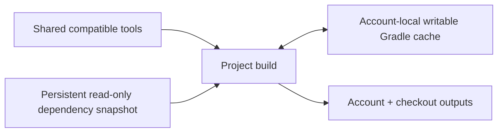

# Reusing build tools and caches across projects

A practical guide for Gradle/Android projects on a shared development machine. The examples use POSIX shells; Windows/IDE differences are covered below. Adapt versions and paths to the destination project. This guide documents setup procedures; it does not authorize builds, downloads, installations or changes in another repository.

## 1. Keep tools, dependencies and outputs separate

| Layer | What it contains | Reuse policy |
| --- | --- | --- |
| Installed tools | JDK, Android SDK packages, extracted Gradle distribution | Reuse compatible installed versions. A shared installation should be maintained deliberately, not modified by ordinary builds. |
| Wrapper distributions | Gradle ZIP/extracted distribution under `wrapper/dists` | The wrapper selects its pinned distribution; finding another `gradle` executable on PATH does not satisfy it. |
| Dependency cache | Downloaded plugin/library artifacts and resolution metadata in `caches/modules-2` | Reuse through an account cache or a compatible persistent read-only snapshot. |
| Derived caches | Compiled build scripts, artifact transforms, task/configuration caches | Keep writable state account-local; expect recomputation when versions or inputs change. |
| Build outputs | APK/AAB, classes, resources, reports | Keep separate per account and checkout. Dependency reuse does not make these outputs current. |
| Source/configuration | Wrapper properties, build scripts, dependency versions | Commit portable requirements; keep machine paths and credentials outside tracked source. |

Gradle maintains several distinct cache directories; see its [directory reference](https://docs.gradle.org/current/userguide/directory_layout.html). Reusing the executable alone does not reuse downloaded dependencies.



Multiple projects under one account can reuse the same account dependency cache. Multiple accounts can read one prepared dependency snapshot while keeping their writable state separate.

## 2. Inventory before installing or changing anything

Read the target project's wrapper properties, plugin versions, SDK requirements and agent/build policies first. Do not change versions merely to fit an existing installation.

From the project root, these are inspection commands, not builds:

```bash
cat gradle/wrapper/gradle-wrapper.properties
command -v java
command -v gradle
java -version
printf 'JAVA_HOME=%s\nANDROID_HOME=%s\nGRADLE_USER_HOME=%s\nGRADLE_RO_DEP_CACHE=%s\n' \
    "${JAVA_HOME:-}" "${ANDROID_HOME:-}" "${GRADLE_USER_HOME:-}" "${GRADLE_RO_DEP_CACHE:-}"
```

Inspect installed tools and candidate caches in known locations rather than scanning the whole machine. Compare the actual Gradle version, JDK and SDK packages with project requirements. PATH and `JAVA_HOME` may select different installations; the IDE may select yet another Gradle JDK. Keep them intentional. Android documents these distinctions in its [JDK selection guide](https://developer.android.com/build/jdks).

For this repository, `python3 build.py --check` performs the existing toolchain preflight without invoking Gradle. That helper is project-specific; do not assume it exists elsewhere.

## 3. Reuse the exact Gradle distribution

The standard wrapper uses `gradle/wrapper/gradle-wrapper.properties`, not the newest installation on PATH. An extracted Gradle 8.13 does not replace a wrapper pinned to 8.7. Wrapper distribution downloads happen before dependency offline mode can help. Retain the distribution checksum and pinned version. See the [wrapper reference](https://docs.gradle.org/current/userguide/gradle_wrapper.html).

Choose one supported approach:

| Approach | Use when |
| --- | --- |
| Existing wrapper distribution cache | The pinned distribution is already present in the selected Gradle User Home. Keep the wrapper's expected directory layout. |
| Explicit matching installed executable | A compatible installation exists elsewhere. Use a project launcher that preserves project cache/output/version behavior. |
| One-time persistent installation/cache fill | The required distribution is genuinely absent. Obtain approval where required, verify provenance/checksum, and retain it for future use. |

Do not redirect the entire writable Gradle User Home to a shared tool installation merely to reuse one executable. Do not regenerate the wrapper as a routine repair: wrapper regeneration can overwrite local launcher customizations.

### Mukhtabir POSIX launcher

This repository's [gradlew](../../gradlew) accepts either:

```properties
# In ignored local.properties; replace the example with an existing installation.
gradle.home=/opt/toolchains/gradle-8.7
```

```bash
# Equivalent command-scoped selection; takes precedence over gradle.home.
MUKHTABIR_GRADLE_HOME=/opt/toolchains/gradle-8.7 ./gradlew --version
```

These are custom launcher settings, not standard Gradle properties. The launcher checks for the executable and pinned-version launcher JAR before reserving an app version. This checks layout/version naming, not authenticity; use a trusted installation. It then delegates to that installation with account-local cache arguments. With neither setting, normal wrapper distribution lookup/download applies. An invalid configured installation fails explicitly.

`./gradlew --version` checks executable startup; it does not resolve project dependencies, compile source or prove that an offline build will succeed.

## 4. Reuse previously downloaded dependencies

A dependency cache includes artifact files and metadata. Preserve their relative `modules-2` layout; do not copy only JARs. Cache metadata must be compatible with the consuming Gradle: the 8.7 setup here uses `metadata-2.106`. Recheck compatibility for future versions in the [dependency-cache reference](https://docs.gradle.org/current/userguide/dependency_caching.html).

Use a persistent snapshot made while its source cache is quiescent. Exclude `*.lock` and `gc.properties`. Avoid symlinking a writable cache across accounts or reading a live writer's cache as a supposedly immutable seed.

Expected layout:

```text
<dependency-seed>/
  modules-2/
    files-2.1/
    metadata-<compatible-format>/
```

### Create a snapshot once

The following is a manual setup recipe, not something to run at every build. Replace the source path after inspection. It creates a new destination, refuses to overwrite an existing snapshot, and leaves the source cache unchanged. Ensure adequate disk space and permission to read the cached artifacts. Do not publish a cache containing private dependencies to untrusted users.

```bash
python3 - <<'PY'
from pathlib import Path
import shutil

source = Path('/path/to/existing/gradle-user-home/caches/modules-2')
destination = Path.home() / '.gradle/dependency-seed-v1/modules-2'
if not (source / 'files-2.1').is_dir():
    raise SystemExit('Select an existing populated modules-2 cache first.')
if destination.exists():
    raise SystemExit('Destination exists; choose a new snapshot name.')
shutil.copytree(source, destination,
                ignore=shutil.ignore_patterns('*.lock', 'gc.properties'))
print(destination.parent)
PY
```

If copying fails, do not configure the partial destination. Inspect the failure and complete a fresh snapshot deliberately. Do not merge live metadata directories blindly. For a shared seed, let a designated owner publish snapshots with read access for consumers; ordinary builds must not update them.

### Select the snapshot

Standard Gradle reads `GRADLE_RO_DEP_CACHE`, pointing to the **parent of `modules-2`**:

```bash
export GRADLE_RO_DEP_CACHE="$HOME/.gradle/dependency-seed-v1"
```

Gradle consults both that snapshot and its writable account cache. Available cached dependencies can be reused; missing ones can download into the writable cache in normal mode. A read-only snapshot does not provide script/transform/task caches. [Gradle read-only-cache guidance](https://docs.gradle.org/current/userguide/dependency_caching.html#sec:shared-readonly-cache).

This repository's POSIX wrapper also accepts a local alias:

```properties
gradle.readOnlyCache=/absolute/path/to/dependency-seed-v1
```

The environment setting takes precedence. The wrapper exports it before launching Gradle and reports that the read-only cache is selected. This message proves selection, not dependency completeness. Other projects must use the standard environment variable or implement their own documented launcher support; merely adding this custom property does nothing there.

### Refresh a seed deliberately

Keep normal builds from modifying a published snapshot. When new dependencies are needed, authorize one online cache fill, then produce a new snapshot from a quiescent compatible cache. Switch consumers to it between builds. Retain the previous snapshot until consumers have migrated; do not delete caches as a first response to failures.

## 5. Isolate writable state on shared checkouts

Recommended ownership:

| Location | Owner and access |
| --- | --- |
| Shared Gradle/JDK/SDK installation | Maintainer writes; build accounts read/execute. Coordinate SDK updates. |
| Published dependency snapshot | Publisher writes before publication; consumers only read. |
| `~/.gradle` | Current OS account writes; contains account-specific settings and writable caches. |
| Project/task caches and module outputs | Current account plus checkout namespace writes. |
| Release keys and repository credentials | Explicitly managed private locations; never bundled into a shared seed. |

For shared source trees, a stable hash of the canonical checkout path can identify the checkout beneath an account-owned root. Do not use a project name alone: two checkouts may have the same name. Moving a checkout changes its namespace and can legitimately cause recomputation.

Mukhtabir uses `~/.gradle/mukhtabir/<checkout-hash>/` for project/task caches and module outputs. Its [settings](../../settings.gradle.kts) and [root build configuration](../../build.gradle.kts) apply this isolation; its launchers also pass account-local cache arguments. Treat those files together when adapting the approach. Directly running an installed `gradle` bypasses launcher version reservation and local property aliases.

Do not solve ownership problems with recursive `chmod 777`, running builds as root, deleting locks, or killing unrelated processes. Fix the specific owner/path/configuration problem after identifying the writer. Idle daemons alone do not establish that a build is active.

## 6. Build without surprise downloads

1. Confirm the pinned distribution is available and the dependency seed is selected.
2. Check other active builds, available RAM and memory pressure. Wait/recheck if busy; do not launch competing heavy builds. Obtain build/test approval where the project's policy requires it.
3. Run the smallest relevant task in offline mode first. Preserve versions using the destination project's actual mechanism.
4. Capture the exit status and first relevant failure. Missing coordinates require a targeted cache fill or corrected configuration, not repeated retries.
5. If an online fill is approved, keep versions unchanged, allow the necessary repositories, and retain the resulting cache. Avoid `--refresh-dependencies` unless evidence requires refreshing metadata/artifacts.

Generic example, after the above checks:

```bash
./gradlew --offline --console=plain assembleDebug > /tmp/project-debug.log 2>&1
build_status=$?
printf 'Build exit status: %s\n' "$build_status"
tail -n 60 /tmp/project-debug.log
```

`assembleDebug` is an Android task; choose the appropriate task elsewhere. Offline dependency mode does not prevent every network-capable custom task, toolchain provisioner or SDK installer. Inspect project behavior; it is not a network sandbox.

Mukhtabir verification command:

```bash
./gradlew --offline --console=plain -Pmukhtabir.autoVersion=false assembleDebug \
    > /tmp/mukhtabir-build.log 2>&1
```

The version-preservation property is custom to this project. Ordinary packaging can reserve a version before Gradle starts; cancellation can therefore consume a version even if no APK was produced. Read the destination project's version policy rather than copying this flag unquestioningly.

A successful version check, dependency resolution, compilation, packaging, automated test and device scenario are separate evidence categories. Record which actually completed. Rebuilding solely to prove a documentation edit is unnecessary.

## 7. IDE, Windows and additional projects

Android Studio does not execute a customized shell wrapper during ordinary sync/build. Configure its Gradle JDK/User Home intentionally, and ensure the process inherits `GRADLE_RO_DEP_CACHE`; shell exports made after Studio starts do not retroactively change its environment. The local `gradle.home` and `gradle.readOnlyCache` aliases here are shell-launcher features.

Mukhtabir's Windows launcher still uses the wrapper distribution and does not parse these POSIX aliases. Windows can use standard `GRADLE_RO_DEP_CACHE` with a Windows-readable snapshot path. Verify the wrapper cache, JDK, metadata compatibility and permissions separately. Do not put Linux `/opt` paths into Windows settings.

For every new project, inspect its versions and policies, then reuse compatible shared installations/snapshots. Keep its own wrapper pins, checksum and writable output namespace. Share a prepared cache only among trusted consumers who may access its dependencies. Do not assume that a successful Mukhtabir build validates another project's toolchain.

## 8. Troubleshooting

| Symptom | Inspect first | Appropriate response |
| --- | --- | --- |
| Wrapper downloads Gradle despite an installation under `/opt` | Wrapper pin, selected User Home, configured installation | Select the exact existing version; PATH alone is insufficient. |
| Libraries download again | Actual account cache, read-only seed setting and required artifact versions | Fix cache selection or seed completeness before allowing another download. |
| “Resolving dependencies” with no transfer messages | Cache hits, metadata lookup and task progress | Resolution itself is normal; distinguish it from network downloads. |
| Offline missing-artifact error | Full coordinates, repository identity and compatible metadata | Locate the cached version or approve a targeted persistent fill. |
| Correct seed path but cache ignored | Parent-of-`modules-2` layout, readability, metadata version, launching process environment | Correct the specific mismatch; do not delete all caches. |
| Compilation/transforms run again | Changed inputs, Gradle/JDK/plugin versions and output namespace | Recomputed outputs can be expected even when dependencies are reused. |
| Lock/permission failure | Account ownership, active writer and shared writable paths | Coordinate with the writer; retain account-local writes. |
| Native-library initialization fails only in an agent sandbox | Account-cache access and the nested cause | Establish whether access is blocked before blaming the installation; use approved cache access. |
| Build uses unexpected Java | Terminal `JAVA_HOME`/PATH versus IDE Gradle JDK | Select an installed compatible JDK; keep source versions intact. |
| A build already running keeps downloading after launcher changes | Environment/configuration captured at process launch | Stop only your own build if desired, then restart with corrected settings/offline mode. |

Keep reusable procedures in this guide. Record project-specific commands, results and remaining gates in that project's verification record; avoid accumulating terminal transcripts here.
